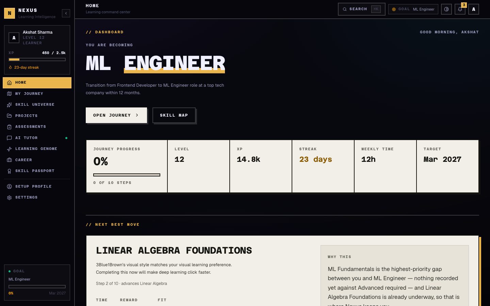
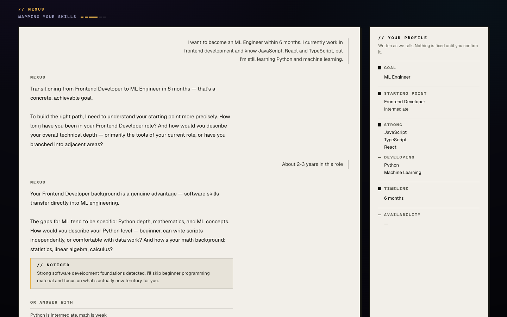
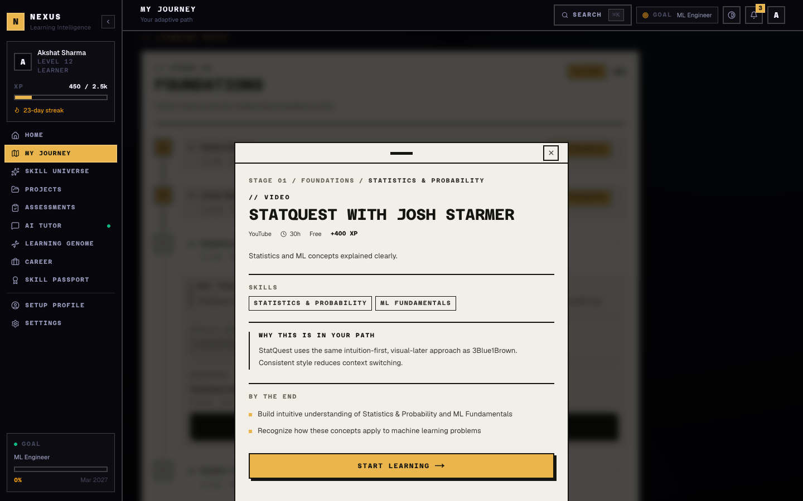
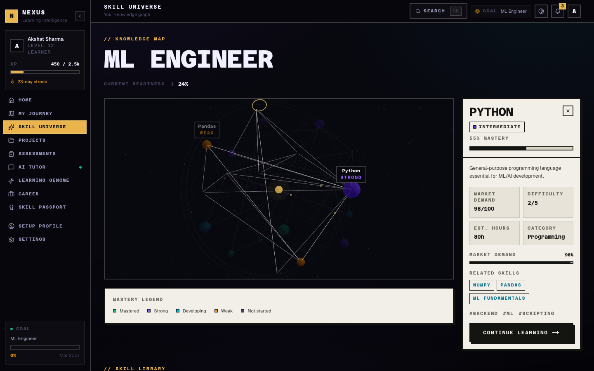
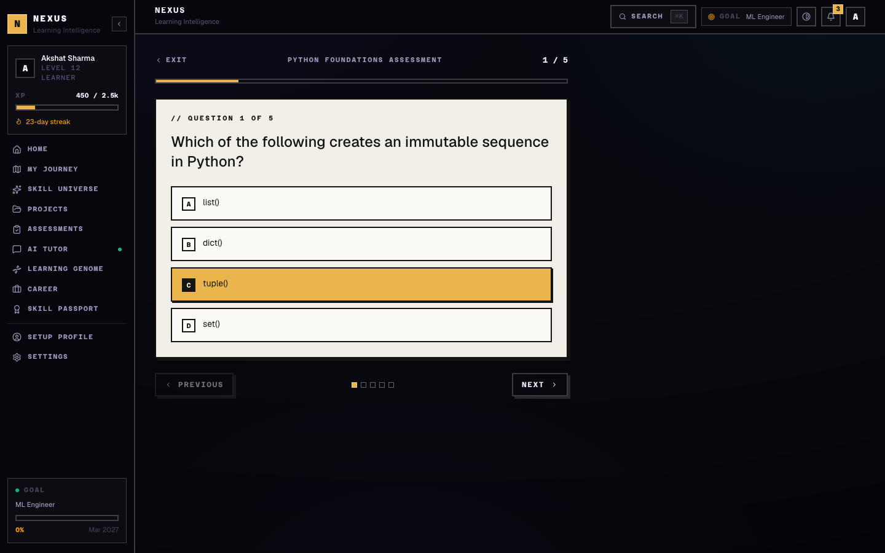
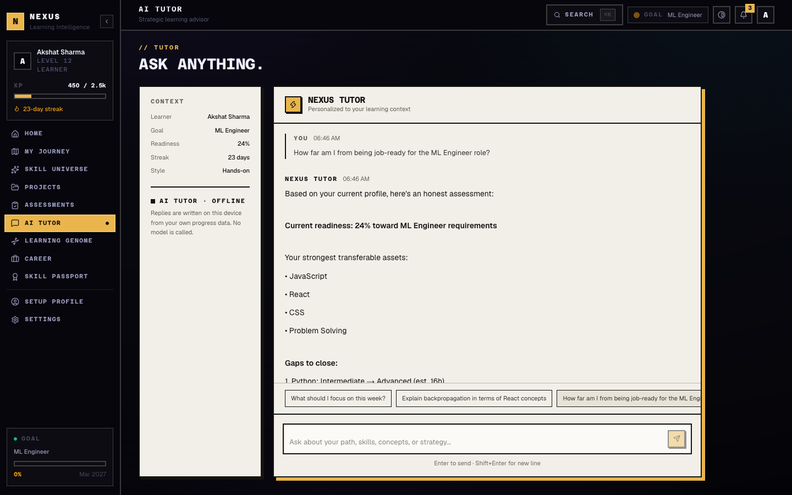
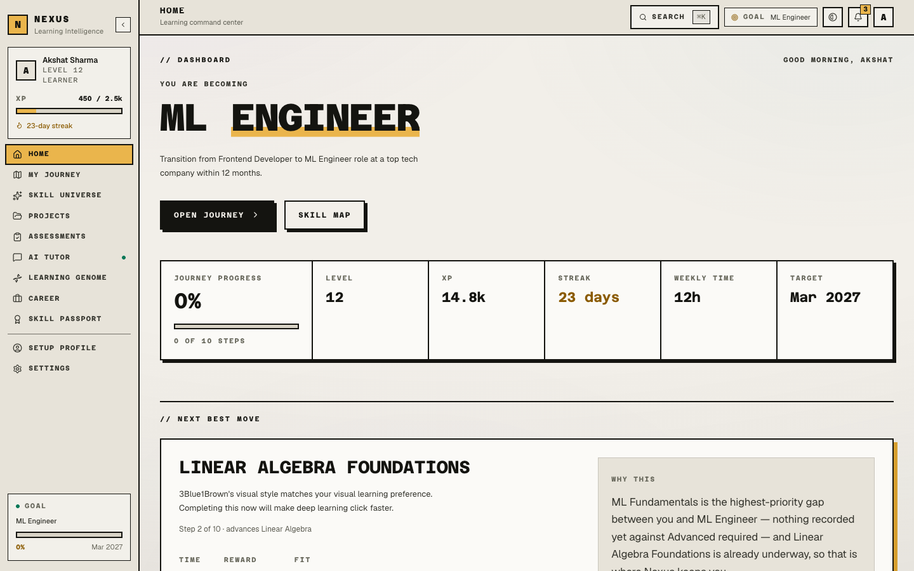
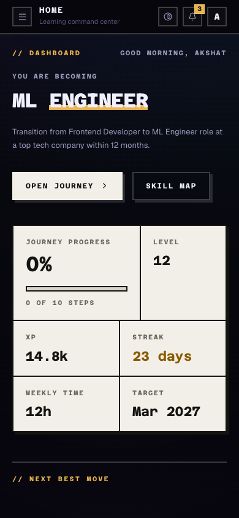

# NEXUS

**A personalized learning platform for career transitions.** Tell it where you want to go in your own words — "I want to become an ML Engineer within 6 months" — and NEXUS profiles your starting point in a short conversation, builds a staged learning path, and tracks what you actually know as you learn.

**[Live demo → nexus-opal-phi-60.vercel.app](https://nexus-opal-phi-60.vercel.app)**



## What it does

- **Conversational onboarding.** Describe your goal and background; NEXUS extracts your target role, timeline, experience and skills, asks the follow-ups it needs, and shows the profile it is building as you talk. You review and correct it before the path is built.
- **One next best move.** Home leads with your target role and the single most useful thing to do next — with the reasoning behind it, not just a recommendation.
- **An adaptive journey.** A staged path of skills, resources, projects and assessments. Steps unlock as their prerequisites complete, and every step opens as a detail sheet.
- **A map of what you know.** The Skill Universe draws every skill as a 3D knowledge map coloured by mastery, alongside a searchable skill library.
- **Assessments that count.** Question-by-question assessments, scored per skill and written back into your mastery, so the map and the path follow your results.
- **A tutor that knows your progress** — and runs fully offline (see below).
- **Career, Skill Passport and Learning Genome** views of readiness, evidence and learning style.
- **Light and dark themes** that follow your system setting, remember your choice, and never flash the wrong one on load.

## Screens

| | |
|---|---|
|  |  |
| **Onboarding** — the profile is written beside the conversation as NEXUS understands it. | **Journey** — each step explains why it is on your path and what it builds. |
|  |  |
| **Skill Universe** — every skill, placed and coloured by mastery. | **Assessments** — results are scored per skill and update your mastery. |
|  |  |
| **Tutor** — answers from your own progress data, offline. | **Light theme** — the same design printed on lighter stock. |

<p align="center">
  
  <br><em>Responsive down to phone widths.</em>
</p>

## The tutor runs offline

The tutor answers from your own learning data — your readiness, your top skill gaps, your weekly time — and those replies are written in your browser. **No AI model is called and nothing is billed.** That is the default, and it is what the live demo runs.

The tutor can optionally use Claude instead. It does so only when **both** of these are set; a key on its own does nothing:

```bash
ANTHROPIC_API_KEY=your_key
TUTOR_AI_ENABLED=true
```

Every AI reply is billed to your Anthropic account, and the tutor endpoint has no login or rate limiting, so don't switch it on for a public deployment.

## Your data stays in your browser

There are no accounts and no database. Your profile, progress, mastery and settings are saved in your browser's `localStorage`, so they stay on your device. **Settings → Export my data** downloads all of it as JSON, and **Reset local data** clears it.

## Running it locally

Requires Node.js 20.9 or later.

```bash
npm install
npm run dev      # http://localhost:3000
```

```bash
npm run build    # production build (type-checked)
npm run start    # serve the production build
npm run lint     # ESLint
```

## Deploying

The app deploys to [Vercel](https://vercel.com) with no configuration: import the repository and deploy. No environment variables are needed — without them the tutor stays offline.

## Tech stack

[Next.js 16](https://nextjs.org) (App Router, Turbopack) · React 19 · TypeScript · Tailwind CSS v4 · Framer Motion · Three.js with React Three Fiber · Lucide icons · Anthropic SDK (optional tutor)

## Design

The interface uses an editorial design language: cream paper sheets laid on a near-black room, 2px ink rules, hard offset shadows with no blur, a heavy monospace display face (Azeret Mono), and amber used as a printed block rather than a glow. Colour comes from CSS custom properties, and a `.k-paper` sheet re-declares them so everything inside it re-inks for paper — which is also how the light theme works. The system is documented inline in [`src/app/globals.css`](src/app/globals.css).

## Project structure

```
src/app/          routes — one folder per page, plus the tutor API
src/components/   layout (shell, rail, top bar), UI primitives, onboarding, the 3D map
src/lib/          state contexts, services (mastery, recommendations, onboarding), seed data
docs/             architecture notes and screenshots
```

See [`docs/ARCHITECTURE.md`](docs/ARCHITECTURE.md) for how the data model and services fit together.
