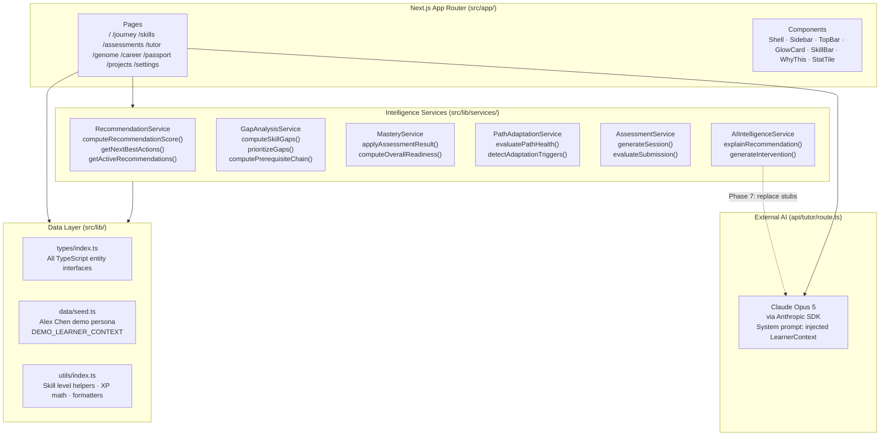

# NEXUS — System Architecture

## Overview

NEXUS is an AI-powered personalized learning platform. Its core premise is that every decision the system makes — what to recommend, how to sequence the path, when to adapt — must be **explainable** and **inspectable**. The architecture enforces this by separating intelligence into two clearly bounded layers.

---

## System Layers



---

## Core Data Flow

### Personalization dependency chain

```
LearnerContext
  ├── User              (identity, XP, streak)
  ├── LearnerProfile    (role, education, strengths/weaknesses, preferences)
  ├── Goal              (target role, required skills + levels, target date)
  ├── SkillMastery[]    (current level, score, evidence, confidence)
  ├── Progress          (XP, hours, weekly activity, milestones)
  └── LearningBehavior  (velocity, practice preference, consistency, challenge tolerance)
         │
         ▼
  GapAnalysisService.computeSkillGaps()
         │
         ▼
  SkillGap[]            (current → required, gapScore, priority, estimatedHours)
         │
         ▼
  RecommendationService (RecommendationScore per resource, sorted by totalScore)
         │
         ▼
  Recommendation[]      (with full RecommendationScore for "Why this?" display)
         │
         ▼
  PathAdaptationService (path health, schedule adherence, adaptation triggers)
         │
         ▼
  LearningPath updates  (node status changes, new adaptations recorded)
```

### Adaptive assessment loop (Phase 6 wires these together)

```
Assessment taken by learner
         │
         ▼
  AssessmentService.evaluateSubmission() → AssessmentResult
         │
         ▼
  MasteryService.applyAssessmentResult() → updated SkillMastery[]
         │
         ▼
  GapAnalysisService.computeSkillGaps() → updated SkillGap[]
         │
         ▼
  RecommendationService (re-scored with new context) → updated Recommendations
         │
         ▼
  PathAdaptationService.detectAdaptationTriggers() → PathAdaptation candidates
         │
         ▼
  LearningPath.adaptationHistory updated, nodes re-ordered/unlocked
```

---

## Intelligence Boundary

### Deterministic (algorithm — guaranteed correctness)

| Responsibility | Service |
|---|---|
| Prerequisite validation (graph traversal) | `GapAnalysisService` |
| Skill gap calculations (level delta) | `GapAnalysisService` |
| Recommendation scoring (weighted factors) | `RecommendationService` |
| Path constraint enforcement (unlock conditions) | `PathAdaptationService` |
| Mastery score updates from assessment | `MasteryService` |
| Path health (schedule vs actual progress) | `PathAdaptationService` |
| XP / level progression math | `utils/index.ts` |

**Rule:** The deterministic layer is never bypassed. AI cannot override prerequisite enforcement or scoring math.

### AI (LLM-powered — language understanding required)

| Responsibility | Current | Phase 7 |
|---|---|---|
| Goal interpretation from natural language | stub | Claude Opus 5 |
| Recommendation explanation ("Why this?") | seed text | Claude Opus 5 |
| Assessment feedback generation | stub | Claude Opus 5 |
| Learning intervention messages | static strings | Claude Opus 5 |
| Adaptive question selection | not implemented | Claude Opus 5 |
| Project brief generation | stub | Claude Opus 5 |
| Conversational tutoring | **live** (`api/tutor/route.ts`) | Claude Opus 5 |

---

## Recommendation Score

Every recommendation is scored across 8 independently inspectable factors via `RecommendationScore`. No single black-box score.

```typescript
interface RecommendationScore {
  totalScore: number;       // weighted aggregate
  goalAlignment: number;    // does this close a goal skill gap?
  skillGapScore: number;    // how severe is the gap?
  prerequisiteScore: number;// are prerequisites met?
  difficultyFit: number;    // matches current level + challenge tolerance?
  timeFit: number;          // fits available weekly hours?
  preferenceFit: number;    // resource type matches preferences?
  behaviorFit: number;      // matches observed behavioral patterns?
  resourceQuality: number;  // rating, review count, freshness
  reasons: RecommendationReason[];
}
```

**LearningBehavior influence on scoring:**
- `practicePreference` high → `behaviorFit` boosts project/interactive resources
- `challengeTolerance` high → `difficultyFit` favors harder resources
- `consistency` low → `PathAdaptationService` adds spaced-review nodes

---

## Multi-Learner Architecture

Services are stateless functions that accept `LearnerContext` as input. There is no global learner state in services.

```typescript
// Every service function accepts a learner-specific context:
getPathHealthReport(context?: LearnerContext)    // defaults to demo for pages
computeSkillGaps(masteries, goal, skills)         // pure, no globals
prioritizeGaps(gaps, context)                     // behavior-adjusted per learner
```

The demo experience uses `DEMO_LEARNER_CONTEXT` exported from `seed.ts`. When onboarding and auth are implemented (Phase 4), each user session provides its own `LearnerContext` from the database.

---

## Core Entities

| Entity | Key Fields | Lives In |
|---|---|---|
| `User` | id, name, xp, level, streakDays | `types/index.ts` |
| `LearnerProfile` | currentRole, targetRole, strengths, preferredResourceTypes | `types/index.ts` |
| `LearnerPreferences` | resourceTypes, learningStyle, weeklyHoursAvailable | `types/index.ts` |
| `LearningBehavior` | velocity, practicePreference, consistency, challengeTolerance | `types/index.ts` |
| `LearnerContext` | user + profile + goal + masteries + progress + behavior | `types/index.ts` |
| `Goal` | requiredSkills[], targetDate, progressPercent | `types/index.ts` |
| `Skill` | prerequisites[], related[], demandScore, difficulty | `types/index.ts` |
| `SkillWithContext` | extends Skill + mastery + goalRelevance + dependents | `types/index.ts` |
| `SkillMastery` | level, score, evidence[], confidenceScore, trending | `types/index.ts` |
| `SkillGap` | currentLevel → requiredLevel, gapScore, priority | `types/index.ts` |
| `RecommendationScore` | 8 factor scores + reasons | `types/index.ts` |
| `LearningPath` | nodes[], adaptationHistory[], progressPercent | `types/index.ts` |
| `PathNode` | type, status, unlockConditions[], whyRecommended | `types/index.ts` |
| `AssessmentSession` | questions[], answers, timeLimit | `types/index.ts` |

---

## Future Database Boundary

Currently: all data is in `src/lib/data/seed.ts` (demo persona only).

When persistence is added (Phase 4):
- `seed.ts` becomes the **default/fallback** for unauthenticated demo
- A `db/` layer (Prisma + Postgres recommended) provides `getLearnerContext(userId)` 
- Service functions already accept `LearnerContext` — no service changes required
- Pages switch from importing `DEMO_LEARNER_CONTEXT` to fetching per-user context

```
src/lib/db/             ← Phase 4
  learner.ts            getLearnerContext(userId: string): Promise<LearnerContext>
  progress.ts           updateProgress(...)
  mastery.ts            persistMasteryUpdate(...)
```

---

## Future LLM Boundary

The `AIIntelligenceService` in `src/lib/services/ai-intelligence.ts` defines the complete interface for all AI-powered features. Every method currently has a deterministic stub.

Phase 7 replacement: inject `LearnerContext` into a Claude Opus 5 system prompt per method, stream responses where appropriate, fall back to stubs on API failure.

The AI Tutor (`src/app/api/tutor/route.ts`) is **offline by default**: every reply is written in the browser from the learner's own progress data, and no model is called, so a deployment cannot incur API charges. It calls Claude only when **both** `ANTHROPIC_API_KEY` and `TUTOR_AI_ENABLED=true` are set (`src/lib/tutor-ai.ts`) — a key on its own does nothing, so one added to a deployment's environment cannot start billing by itself. With AI on, the full learner context goes into the system prompt, and a failed request falls back to a local reply for that message.

---

## Running the Application

```bash
npm run dev      # Development server at localhost:3000
npm run build    # Production build (TypeScript checked)
npm run lint     # ESLint

# Optional: enable the live AI Tutor (bills your Anthropic account per message).
# Both lines are required; without them the tutor stays offline and free.
echo "ANTHROPIC_API_KEY=your_key" >> .env.local
echo "TUTOR_AI_ENABLED=true" >> .env.local
```

Routes: `/` · `/journey` · `/skills` · `/assessments` · `/tutor` · `/genome` · `/career` · `/passport` · `/projects` · `/settings`
